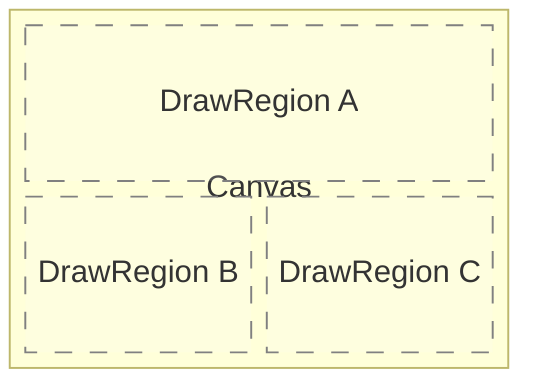
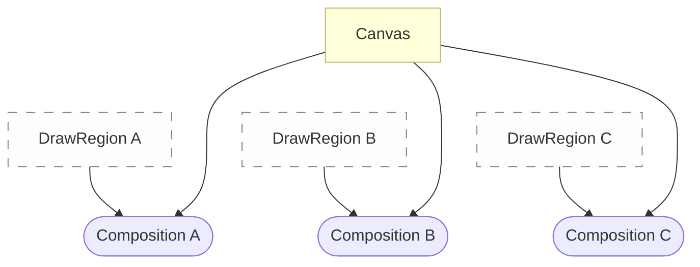

# Frame rendering

## Canvas to render on

All rendering is done on a part of a `Canvas` asset.
Which part is specified with a `DrawRegion` object.

A `Canvas` describes all images we will draw on,
and memory buffers that are needed for rendering.
This among the others contains the image that will be shown to the player.

A `DrawRegion` describes which part of a frame we will draw on.
Imagine split-screen games - they have multiple `DrawRegion`s.

This is often used to repeat the same composition (a sequence of `ComposeMethod`s)
on multiple parts of the `Canvas` while adjusting a small number of parameters and values.
So multiple compositions can use the same `Canvas`,
and multiple compositions can use the same `DrawRegion`,
but they can also combine them however they want.

Let's say we have this screen configuration for a 3-player split-screen game:

In that case we would need 3 `DrawRegions`s, one for each composition:

## Composition graph
