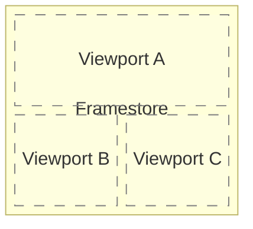
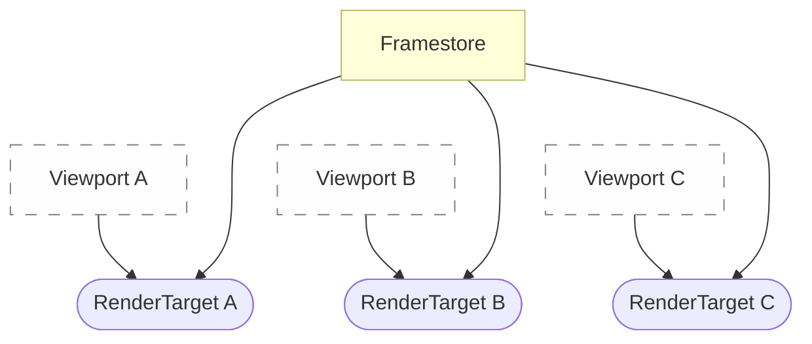
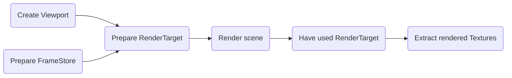

# Frame rendering

## Target to render

All rendering is done on a `RenderTarget` object.
`RenderTarget` is like a part of the canvas we draw our image on.
It mainly binds 2 other objects:
- a `Viewport` - Describes which part of a frame we will draw on.
Imagine split-screen games - they have multiple `Viewport`s.
- a `FrameStore` - Describes all images we will draw on,
and memory buffers that are needed for rendering.
This is among the rest contains the image that will be shown to the player.

So multiple `RenderTargets` can use the same `FrameStore`,
and multiple `RenderTargets` can use the same `Viewport`,
but they can also combine them however they want
(usually you won't have multiple `RenderTarget`s that describe the same set of the two).

Let's say we have this screen configuration for a 3-player split-screen game:

In that case we would need 3 `RenderTarget`s, one for each `Viewport`:

## Composition graph
